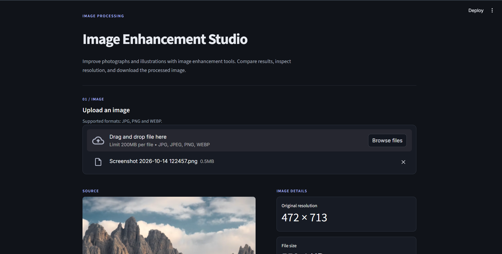
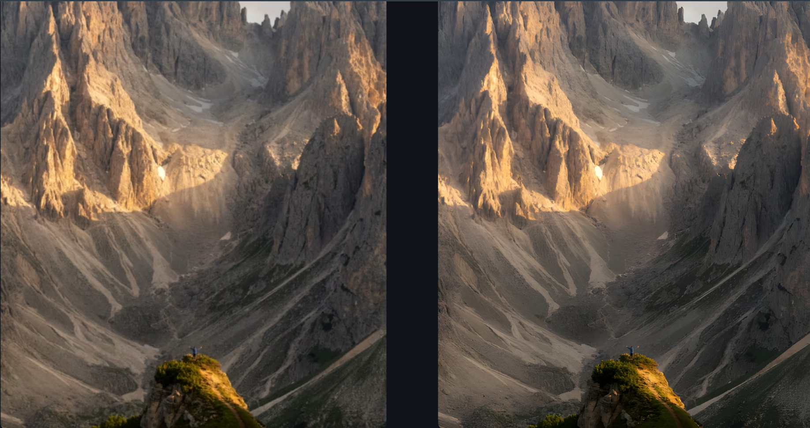

# Image Enhancement Studio

A computer vision project exploring image enhancement, super-resolution, and image reconstruction using Python, PyTorch, and Real-ESRGAN.

The application provides a simple interface for enhancing photographs and illustrations, comparing results, and downloading processed images. It also includes a custom CNN experiment developed and trained as part of this project.

## Application Preview

### Main Interface



### Before and After Enhancement



## Features

- Upload images in JPG, JPEG, PNG, and WEBP formats.
- Enhance full-resolution images using a pretrained Real-ESRGAN model.
- Compare original and enhanced images side by side.
- View image dimensions and output resolution.
- Download enhanced images as PNG files.
- Experiment with a custom PyTorch CNN.
- Compare bicubic interpolation and CNN reconstruction using PSNR and SSIM.

## Technologies Used

- **Python** — application development
- **PyTorch and Torchvision** — CNN implementation, training, and inference
- **Real-ESRGAN** — pretrained image enhancement and super-resolution
- **Streamlit** — interactive application interface
- **NumPy and Pillow** — image handling and array operations
- **OpenCV and scikit-image** — image processing and quality evaluation
- **Matplotlib** — visualizing images and experiment results

## How It Works

The project combines two approaches to image enhancement.

### 1. Real-ESRGAN

The application integrates a pretrained Real-ESRGAN model for enhancing full-resolution photographs and illustrations. The current application uses the `realesrgan-x4plus` model to produce an output with four times the original width and height.

The pretrained model is integrated into this project; it was not trained from scratch by the project author.

### 2. Custom CNN Experiment

A convolutional neural network was implemented in PyTorch and trained using the CIFAR-10 dataset.

The experiment uses the following pipeline:

1. Start with an original 32 × 32 image.
2. Reduce it to 8 × 8 pixels.
3. Reconstruct it to 32 × 32 using bicubic interpolation.
4. Train the CNN to predict an image closer to the original.
5. Evaluate reconstruction quality using PSNR and SSIM.

The CNN experiment demonstrates the training and evaluation process. Because it was trained on small CIFAR-10 images, it is not intended to be a general-purpose photo restoration model.

## Project Structure

```text
ai-image-enhancement/
├── app.py
├── ai_enhancement_project.ipynb
├── image_enhancement_cnn.pth
├── requirements.txt
├── .gitignore
├── README.md
└── screenshots/
    ├── intro.png
    └── result.png
```

The Real-ESRGAN executable and its model files are downloaded separately and are not included in the repository.

## Getting Started

### Prerequisites

- Python installed on your computer
- Git
- The Real-ESRGAN Windows release and its model files

### 1. Clone the repository

```bash
git clone https://github.com/rohan-mad/ai-enhancement-studio.git
cd ai-enhancement-studio
```

### 2. Create a virtual environment

```bash
python -m venv .venv
```

On Windows PowerShell, activate it with:

```powershell
.\.venv\Scripts\Activate.ps1
```

### 3. Install Python dependencies

```bash
python -m pip install --upgrade pip
pip install -r requirements.txt
```

### 4. Set up Real-ESRGAN

Download the appropriate Windows release from the official repository:

https://github.com/xinntao/Real-ESRGAN/releases

Extract the release into the project directory. Keep the executable `realesrgan-ncnn-vulkan.exe` together with its accompanying `models` folder.

The application expects the extracted folder to be named either:

- `realesrgan-ncnn-vulkan-20220424-windows`
- `realesrgan`

The executable and required model files must be present for image enhancement to work.

### 5. Run the application

From the project directory, run:

```bash
python -m streamlit run app.py
```

Open the local URL displayed in the terminal to use the application.

### 6. Run the CNN experiment

Open `ai_enhancement_project.ipynb` in Jupyter Notebook or VS Code and execute its cells to explore the dataset, image preprocessing, CNN training, reconstruction, and evaluation.

The notebook downloads CIFAR-10 when needed.

## Evaluation

The notebook compares bicubic interpolation with CNN reconstruction using:

- **Peak Signal-to-Noise Ratio (PSNR):** measures pixel-level reconstruction error.
- **Structural Similarity Index (SSIM):** compares structural image similarity.

Higher PSNR and SSIM generally indicate better reconstruction relative to the reference image. Results depend on the dataset, preprocessing, model, and training configuration.

## Limitations

- The custom CNN was trained on small CIFAR-10 images and may not improve ordinary photographs.
- The pretrained Real-ESRGAN model may sharpen images or generate plausible details that differ from the original scene.
- Enhancement quality varies depending on the image and model.
- Real-ESRGAN must be downloaded separately before its functionality can be used.
- The application currently runs locally; a public hosted version is not included.

## Acknowledgements

This project uses the open-source Real-ESRGAN implementation:

https://github.com/xinntao/Real-ESRGAN

Refer to the original repository and the specific model's terms for licensing, attribution, and usage requirements.

## Author

Developed as a computer vision and deep learning portfolio project.